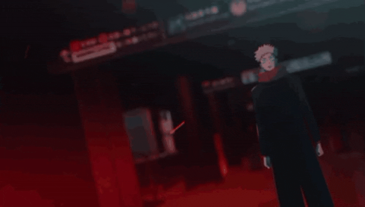

<!-- HEADER -->

  

<!-- GAMBAR / GIF UTAMA KAMU -->

---

## 🎨 Instagram Saya

  

Tempat saya membagikan **karya seni, proses ngoding, dan perjalanan bikin game** 🎮✨
 
Kalau suka, mampir dan follow ya!

  

<!-- GALERI KARYA (3 GAMBAR) -->

  

---
## >> About Me

- Working on a project : **Wandering Heroes**
- Learning : **Godot, Piskel**
- Students at : **Politeknik Negeri Indramayu**
- Fun fact : **I Like Games**
- Residing in : **Jawa Barat, Indonesia 🇮🇩**

---

## >> I once studied

---

## >> Let’s Connect

<!-- FOOTER -->

