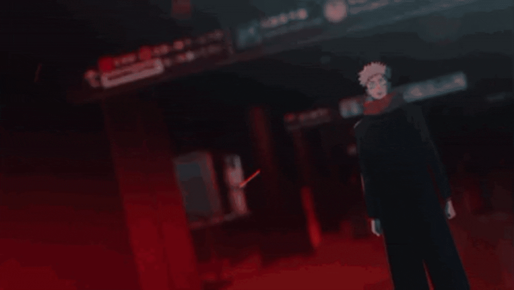
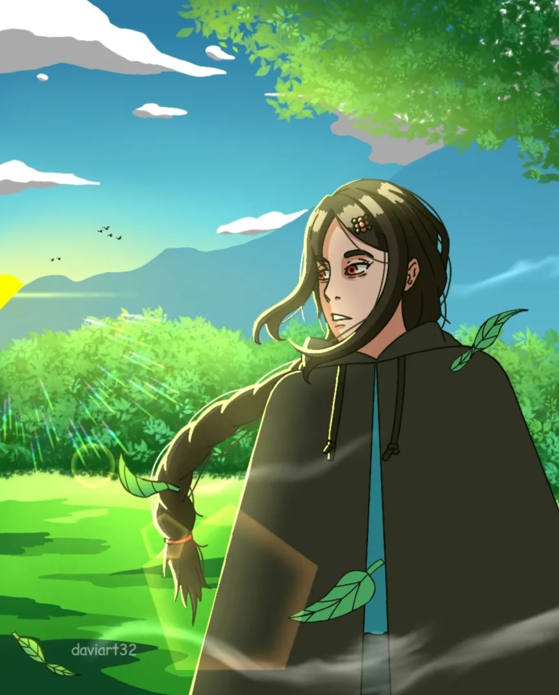
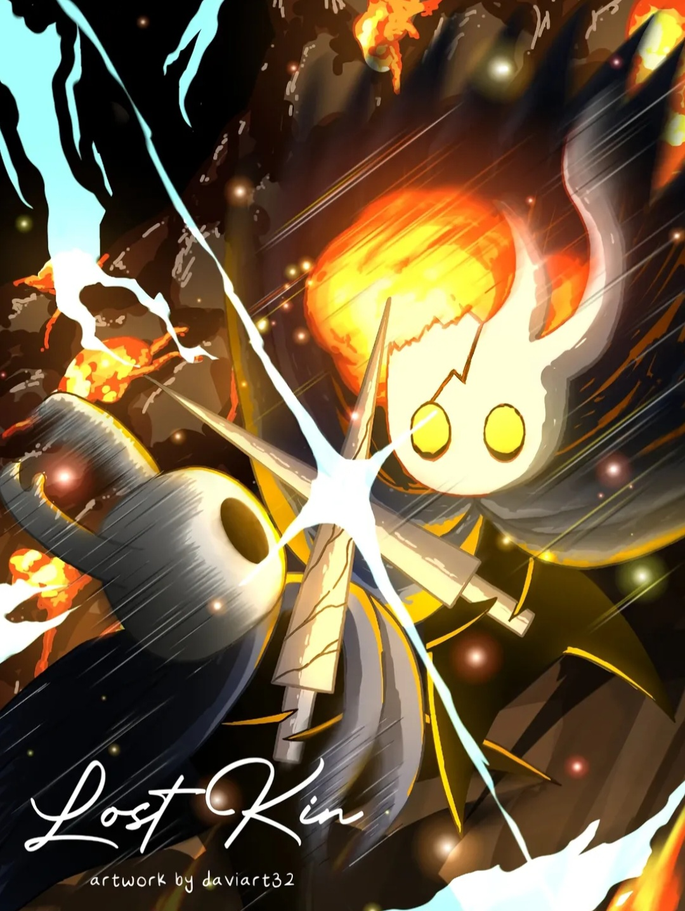
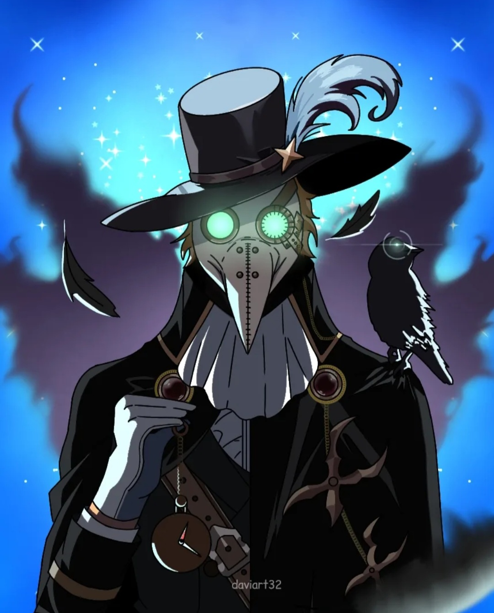

<!-- HEADER -->
---
# | Welcome to my GitHub!

---

<h2 align="center"><b><i>"Stand proud, you are strong."- Ryomen Sukuna</i><b></h2>

  
  **Gif Source : Jujutsu Kaisen**

   

# | My Art

 

A place where I share my artwork. **If you like it, feel free to stop by!**

 
<!-- GALERI KARYA (3 GAMBAR) -->

  

---
# | About Me

- Working on a project : **TBA**
- Learning : **Godot**
- Students at : **Politeknik Negeri Indramayu**
- Fun fact : **I Like Anime**
- Residing in : **Jawa Barat, Indonesia 🇮🇩**

---

# | What do I use?

---

# | Let’s Connect

 

If you are interested, **you can contact me via**

 

<!-- FOOTER -->

